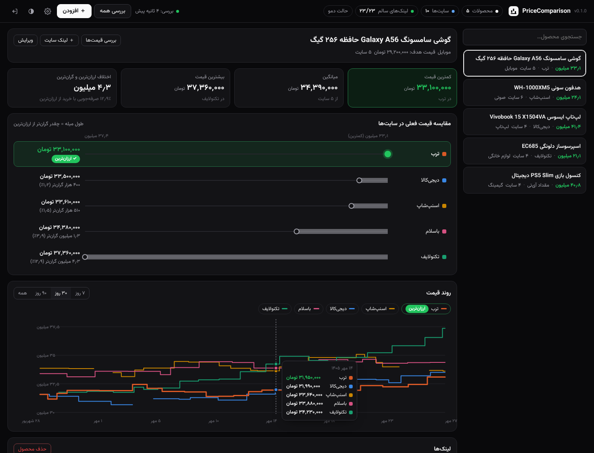
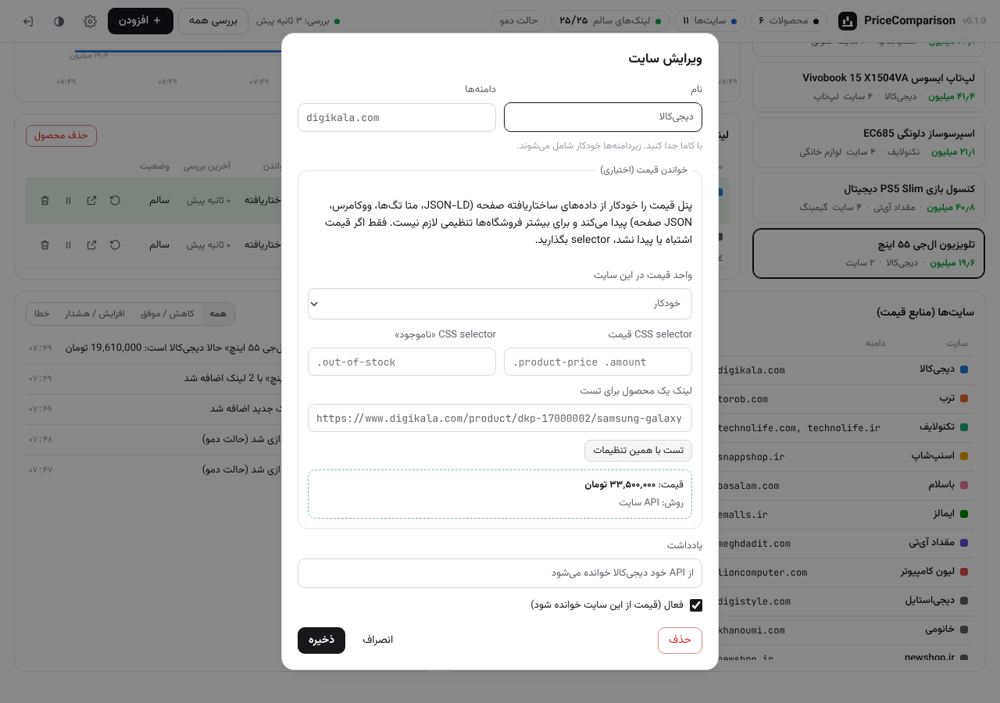
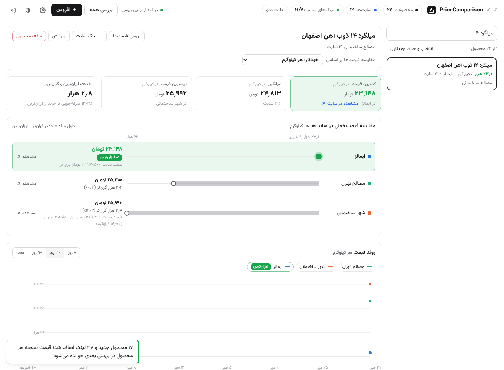
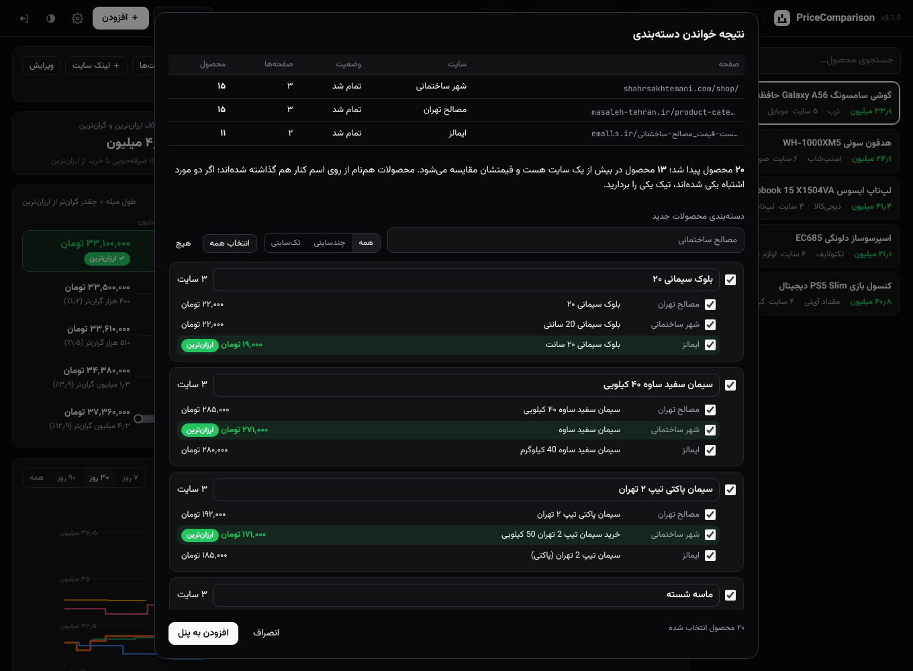

<div dir="rtl">

# PriceComparison

پنل مقایسه قیمت. قیمت هر محصول را به‌صورت دوره‌ای از فروشگاه‌های اینترنتی که خودتان انتخاب می‌کنید می‌خواند و کنار هم با نمودار نشان می‌دهد. **ارزان‌ترین فروشنده با رنگ و برچسب جدا مشخص می‌شود.**

- سایت‌های منبع ثابت نیستند و از داخل پنل اضافه، ویرایش یا حذف می‌شوند.
- قیمت‌ها پیش از مقایسه **به یک واحد** تبدیل می‌شوند (کیلو، تن، کیسه، شاخه و…).
- قیمت‌ها بدون هوش مصنوعی خوانده می‌شوند.



## فهرست

- [امکانات](#امکانات)
- [نقش‌ها و سطح دسترسی](#نقشها-و-سطح-دسترسی)
- [پوشه‌ها](#پوشهها)
- [قیمت چطور خوانده می‌شود](#قیمت-چطور-خوانده-میشود)
- [واحد فروش و مقایسه بر اساس واحد](#واحد-فروش-و-مقایسه-بر-اساس-واحد)
- [ورود محصولات از صفحه دسته‌بندی](#ورود-محصولات-از-صفحه-دستهبندی)
- [نصب روی ویندوز سرور](#نصب-روی-ویندوز-سرور)
- [نصب روی لینوکس (اوبونتو)](#نصب-روی-لینوکس-اوبونتو)
- [دسترسی از اینترنت (reverse proxy)](#دسترسی-از-اینترنت-reverse-proxy)
- [دستورهای خط فرمان](#دستورهای-خط-فرمان)
- [رفع اشکال](#رفع-اشکال)
- [دمو بدون اینترنت](#دمو-بدون-اینترنت)
- [توسعه](#توسعه)
- [محدودیت‌ها](#محدودیتها)

## امکانات

- **محصولات نامحدود:** برای هر محصول لینک صفحه‌اش در هر سایت را می‌دهید. سایت هر لینک از دامنه‌اش پیدا می‌شود و اگر دامنه تعریف نشده باشد، خودکار اضافه می‌شود.
- **سایت‌های قابل تغییر:** این فروشگاه‌ها از اول اضافه شده‌اند: دیجی‌کالا، ترب، تکنولایف، اسنپ‌شاپ، باسلام، ایمالز، مقداد آی‌تی، لیون کامپیوتر، دیجی‌استایل، خانومی، شهر ساختمانی و مصالح تهران. هر کدام را می‌شود غیرفعال یا حذف کرد و هر سایت دیگری را اضافه کرد.
- **ورود یکجای یک دسته:** لینک صفحه دسته‌بندی هر سایت را می‌دهید. همه محصولاتش خوانده می‌شوند و محصول یکسان در سایت‌های مختلف کنار هم قرار می‌گیرد.
- **مقایسه بر اساس واحد:** واحد فروش هر سایت خودکار پیدا می‌شود و قیمت‌ها به یک واحد تبدیل می‌شوند.
- **مقایسه فعلی:**
  - ارزان‌ترین سایت سبز است و برچسب «ارزان‌ترین» دارد.
  - طول میله هر سایت نشان می‌دهد چقدر از ارزان‌ترین گران‌تر است (مبلغ و درصد).
  - با کلیک روی هر سایت، صفحه همان محصول در آن سایت باز می‌شود.
- **روند قیمت:** نمودار خطی برای هر سایت، با بازه ۷، ۳۰ و ۹۰ روزه.
- **رویدادها:** کاهش و افزایش قیمت، ناموجود شدن، عوض شدن ارزان‌ترین فروشنده، رسیدن به «قیمت هدف» و خطا در خواندن یک سایت.
- **سه سطح دسترسی:** مدیر کل، مدیر و کاربر. هر کس پوشه‌های شخصی خودش را دارد، مثل «علاقه‌مندی‌ها».
- **ظاهر:** حالت تاریک و روشن، راست‌چین و سازگار با موبایل. به‌روزرسانی زنده بدون نیاز به رفرش صفحه.

## نقش‌ها و سطح دسترسی

| | مدیر کل | مدیر | کاربر |
|---|:---:|:---:|:---:|
| دیدن محصولات، قیمت‌ها، نمودارها و رویدادها | ✓ | ✓ | ✓ |
| بررسی دوباره قیمت یک محصول | ✓ | ✓ | ✓ |
| پوشه‌های شخصی | ✓ | ✓ | ✓ |
| افزودن، ویرایش و حذف محصول و لینک | ✓ | ✓ | |
| تعیین واحد فروش و واحد مقایسه | ✓ | ✓ | |
| مدیریت سایت‌ها، ورود از دسته‌بندی و «بررسی همه» | ✓ | ✓ | |
| تنظیمات پنل (فاصله بررسی، پراکسی و…) | ✓ | | |
| ساخت، حذف و تغییر نقش کاربران | ✓ | | |

- **مدیر کل اول:** اسکریپت نصب یا صفحه اولین اجرا آن را می‌سازد. نام کاربری پیش‌فرضش `admin` است.
- **ساخت کاربر:** مدیر کل از منوی نام کاربری (بالای صفحه) و گزینه «مدیریت کاربران» کاربر می‌سازد و نقشش را تعیین می‌کند.
- **تغییر رمز:** هر کس از همان منو با «تغییر رمز من» رمز خودش را عوض می‌کند.
- **خروج خودکار:** وقتی رمز یا نقش کسی عوض شود یا حذف شود، همان لحظه از پنل خارج می‌شود.
- **حفاظت:** آخرین مدیر کل را نمی‌شود حذف کرد یا نقشش را پایین آورد.
- **محدودیت در سرور:** محدودیت‌ها فقط با مخفی کردن دکمه‌ها نیست. سرور هم درخواست غیرمجاز را رد می‌کند (خطای 403).
- **ارتقا از نسخه قبل:** اگر پنل قبلاً نصب بوده، قدیمی‌ترین حساب مدیر خودکار مدیر کل می‌شود و رمزش عوض نمی‌شود.

## پوشه‌ها

محصولات را می‌شود در پوشه‌ها دسته‌بندی کرد، مثلاً «علاقه‌مندی‌ها» یا «پروژه ساختمان ونک».

- **«☆ علاقه‌مندی‌ها»** در صفحه هر محصول: با یک کلیک، محصول به علاقه‌مندی‌ها اضافه یا از آن حذف می‌شود. اگر این پوشه هنوز نباشد، خودش ساخته می‌شود.
- **دکمه «پوشه‌ها»** در صفحه هر محصول: محصول را در هر پوشه‌ای که بخواهید می‌گذارد یا از آن درمی‌آورد. پوشه جدید هم همان‌جا ساخته می‌شود.
- **«انتخاب چندتایی»** در فهرست محصولات: چند محصول را یکجا به یک پوشه اضافه یا از آن خارج کنید.
- **فیلتر:** بالای فهرست، با کلیک روی نام هر پوشه فقط محصولات همان پوشه نشان داده می‌شوند. تغییر نام و حذف پوشه هم همان‌جاست.
- **خصوصی بودن:** هر پوشه مال صاحبش است و دیگران، حتی مدیر کل، آن را نمی‌بینند.
- **حذف محصول:** اگر محصولی حذف شود، از پوشه‌های همه هم خارج می‌شود.

## قیمت چطور خوانده می‌شود

برای بیشتر سایت‌ها نیازی به تنظیم نیست. روش‌ها به ترتیب امتحان می‌شوند و اولین نتیجه برداشته می‌شود:

| روش | توضیح |
|---|---|
| API سایت | برای دیجی‌کالا از API عمومی خودش |
| CSS selector | اگر برای سایت در پنل selector تعیین شده باشد، همیشه همین استفاده می‌شود |
| داده ساختاریافته | `schema.org/Product` در JSON-LD. بیشتر فروشگاه‌ها و همه ووکامرس‌هایی که Yoast/RankMath دارند |
| متا تگ | `product:price:amount` و مشابه آن |
| Microdata | `itemprop="price"` |
| ووکامرس | باکس قیمت صفحه محصول، با تشخیص قیمت قبل و بعد از تخفیف |
| JSON صفحه | فیلدهای قیمت در `__NEXT_DATA__` سایت‌های Next.js |
| حدس از متن | اولین «عدد + تومان/ریال» بعد از عنوان محصول. با رنگ هشدار مشخص می‌شود که بهتر است selector بگذارید |

- **تبدیل خودکار:** اعداد فارسی و عربی، جداکننده‌ها، و ریال یا تومان خودکار تبدیل می‌شوند. همه قیمت‌ها به تومان ذخیره می‌شوند.
- **دکمه «تست»:** در فرم هر سایت و هر لینک هست. لینک را یک بار با همان تنظیمات می‌خواند و قیمت، واحد و روش خواندن را نشان می‌دهد.



## واحد فروش و مقایسه بر اساس واحد

سایت‌ها یک کالا را با واحدهای مختلف می‌فروشند. میلگرد را یکی کیلویی، یکی شاخه‌ای و یکی تنی می‌فروشد؛ سیمان را یکی کیسه‌ای و یکی تنی. پنل واحد فروش هر سایت را پیدا می‌کند، همه قیمت‌ها را به یک واحد تبدیل می‌کند و بعد مقایسه می‌کند.

**منبع تشخیص واحد** (به ترتیب، اولین مورد برداشته می‌شود):

| منبع | مثال |
|---|---|
| متن کنار قیمت | «۲۵٬۰۰۰ تومان / کیلوگرم»، «قیمت هر شاخه»، «(هر تن)» |
| داده ساختاریافته | `unitCode` در JSON-LD (مثل `KGM`، `TNE`، `MTK`) |
| جدول مشخصات | «واحد فروش: کیسه» و «وزن: ۵۰ کیلوگرم» |
| نام محصول | «سیمان تیپ ۲ پاکتی ۵۰ کیلویی»، «ماسه (تنی)»، «رول ۱۰ متر مربعی» |
| اندازه رایج (فرض) | کیسه سیمان ۵۰ کیلو، گچ ۴۰ کیلو، چسب کاشی ۲۰ کیلو، شاخه میلگرد ۱۲ متری |

- **تبدیل‌ها:** کیلو، تن و گرم با هم؛ لیتر و متر مکعب با هم؛ متر، متر مربع و عدد هر کدام جدا. وزن شاخه میلگرد از روی قطر حساب می‌شود (`قطر² ÷ ۱۶۲` کیلو در هر متر). به همین دلیل قیمت شاخه‌ای با قیمت کیلویی و تنی مقایسه‌پذیر است.
- **واحد مقایسه:** واحدی که بیشتر سایت‌ها با آن می‌فروشند خودکار انتخاب می‌شود. مدیر می‌تواند آن را از بالای صفحه محصول عوض کند. همه قیمت‌ها، ارزان‌ترین سایت، نمودارها و قیمت هدف بر اساس همین واحد هستند.
- **واحد نامشخص یا ناسازگار:** سایتی که واحدش پیدا نشده («واحد نامشخص») یا واحدش قابل تبدیل نیست («واحد متفاوت») در مقایسه حساب نمی‌شود و با رنگ هشدار نشان داده می‌شود. مدیر با «تعیین واحد» واحدش را دستی می‌نویسد، مثلاً «کیسه ۵۰ کیلویی» یا «هر تن». واحد دستی همیشه بر تشخیص خودکار مقدم است.
- **بدون واحد:** اگر واحد هیچ سایتی معلوم نباشد (مثل گوشی موبایل)، قیمت‌ها همان‌طور که هستند مقایسه می‌شوند.



## ورود محصولات از صفحه دسته‌بندی

از منوی «＋ افزودن» گزینه «ورود محصولات از صفحه دسته‌بندی» را بزنید و لینک صفحه دسته‌بندی هر سایت را بدهید، هر خط یک لینک:

```
https://shahrsakhtemani.com/shop/
https://masaleh-tehran.ir/product-category/building-materials/
https://emalls.ir/لیست-قیمت_مصالح-ساختمانی~Category~70445
```

1. **خواندن همه صفحه‌ها:** صفحه بعد از لینک «بعدی» پیدا می‌شود. اگر صفحه چنین لینکی نداشته باشد، آدرسش حدس زده می‌شود (`/page/2/` در ووکامرس و `~page~2` در ایمالز).
2. **پیدا کردن محصولات:** نام، لینک، قیمت و واحد هر محصول از کارت‌های صفحه دسته‌بندی برداشته می‌شود.
3. **کنار هم گذاشتن محصولات یکسان از روی نام:**
   - کلماتی مثل «خرید» و «قیمت» و اندازه بسته (۴۰ کیلویی، ۲۵ کیلویی) نادیده گرفته می‌شوند.
   - اگر عدد اصلی فرق کند (میلگرد ۱۲ و ۱۴) یا بسته‌بندی فرق کند (پاکتی و فله)، دو محصول هرگز یکی نمی‌شوند.
   - محصولی که از قبل در پنل هست، به همان محصول وصل می‌شود.
4. **بازبینی:** قبل از افزودن، فهرست را می‌بینید. اسم هر محصول را می‌شود عوض کرد و هر محصول یا لینکی را که اشتباه کنار هم گذاشته شده می‌شود حذف کرد.
5. **قیمت اولیه:** قیمت صفحه دسته‌بندی همان لحظه در نمودار ثبت می‌شود. بررسی بعدی، صفحه خود محصول را می‌خواند.

اگر محصولات یک سایت خودکار پیدا نشد، در تنظیمات همان سایت «selector لینک محصول در صفحه دسته‌بندی» را بگذارید.



## نصب روی ویندوز سرور

ویندوز سرور ۲۰۱۶، ۲۰۱۹ یا ۲۰۲۲. همه مراحل داخل ریموت دسکتاپ (RDP) سرور انجام می‌شود.

> **مهم:** بیشتر فروشگاه‌های ایرانی درخواست از IP خارج را رد می‌کنند. سرور باید **داخل ایران** باشد، یا در تنظیمات پنل یک پراکسی ایران بدهید.

**باز کردن PowerShell:** همه دستورها در **PowerShell با دسترسی Administrator** اجرا می‌شوند، نه Command Prompt. منوی Start را باز کنید، بنویسید `powershell`، روی **Windows PowerShell** کلیک راست کنید و **Run as administrator** را بزنید.

### ۱. بررسی‌های اولیه

```powershell
py --version                                                    # اگر خطا داد، پایتون نصب نیست (مرحله ۲)
curl.exe -sI https://www.python.org | Select-Object -First 1     # دسترسی به اینترنت
curl.exe -sI https://masaleh-tehran.ir | Select-Object -First 1  # دسترسی به سایت‌های ایرانی؛ باید 200 یا 301 بدهد
```

### ۲. نصب پایتون ۳.۱۲

```powershell
[Net.ServicePointManager]::SecurityProtocol = [Net.SecurityProtocolType]::Tls12
Invoke-WebRequest https://www.python.org/ftp/python/3.12.10/python-3.12.10-amd64.exe -OutFile $env:TEMP\python-setup.exe
Start-Process $env:TEMP\python-setup.exe -ArgumentList "/quiet InstallAllUsers=1 PrependPath=1" -Wait
```

بعد پنجره PowerShell را ببندید و دوباره با **Run as administrator** باز کنید تا مسیر پایتون شناخته شود.

### ۳. دانلود پنل

```powershell
[Net.ServicePointManager]::SecurityProtocol = [Net.SecurityProtocolType]::Tls12
Invoke-WebRequest https://github.com/MHBehzadian/PriceComparison/archive/refs/heads/main.zip -OutFile $env:TEMP\pc.zip
Expand-Archive $env:TEMP\pc.zip -DestinationPath C:\ -Force
Rename-Item C:\PriceComparison-main C:\PriceComparison
```

اگر Git نصب است، به‌جای این سه خط بزنید: `git clone https://github.com/MHBehzadian/PriceComparison.git C:\PriceComparison`

### ۴. نصب و راه‌اندازی

```powershell
cd C:\PriceComparison
powershell -ExecutionPolicy Bypass -File deploy\windows\install.ps1
```

کارهایی که اسکریپت انجام می‌دهد:

1. محیط پایتون را در `C:\PriceComparison\venv` می‌سازد و پکیج‌ها را نصب می‌کند.
2. حساب **مدیر کل** با نام `admin` و یک رمز تصادفی می‌سازد و رمز را با رنگ زرد چاپ می‌کند. **یادداشتش کنید.**
3. پنل را به‌شکل یک Scheduled Task زیر حساب SYSTEM ثبت می‌کند. پنل با روشن شدن ویندوز بالا می‌آید، با خروج از ریموت خاموش نمی‌شود و اگر متوقف شود ظرف ۵ دقیقه دوباره اجرا می‌شود.
4. پورت را در فایروال ویندوز باز می‌کند، صبر می‌کند تا پنل جواب بدهد و آدرسش را نشان می‌دهد.

گزینه‌های اسکریپت:

| گزینه | کار |
|---|---|
| `-Port 9091` | پورت پنل (پیش‌فرض 8090). اگر پورت اشغال باشد، اسکریپت قبل از هر تغییری متوقف می‌شود |
| `-DataDir D:\PriceData` | محل نگهداری داده‌ها (پیش‌فرض `C:\ProgramData\PriceComparison`) |
| `-TrustedProxy 192.168.1.20` | آی‌پی reverse proxy که پنل را روی اینترنت منتشر می‌کند ([جزئیات](#دسترسی-از-اینترنت-reverse-proxy)) |
| `-Wheels C:\wheels` | نصب پکیج‌ها از یک پوشه، برای سروری که به pypi دسترسی ندارد |

### ۵. باز کردن پنل

- **روی خود سرور:** `http://localhost:8090`
- **از کامپیوترهای دیگر شبکه:** `http://IP-سرور:8090`. آی‌پی سرور با دستور `ipconfig` معلوم می‌شود. اگر باز نشد، فایروال شبکه شرکت (جدا از فایروال ویندوز) باید پورت را باز کند.
- **از بیرون شرکت:** بخش [دسترسی از اینترنت](#دسترسی-از-اینترنت-reverse-proxy) را ببینید.

### به‌روزرسانی

```powershell
[Net.ServicePointManager]::SecurityProtocol = [Net.SecurityProtocolType]::Tls12
Invoke-WebRequest https://github.com/MHBehzadian/PriceComparison/archive/refs/heads/main.zip -OutFile $env:TEMP\pc.zip
Remove-Item $env:TEMP\pc -Recurse -Force -ErrorAction SilentlyContinue
Expand-Archive $env:TEMP\pc.zip -DestinationPath $env:TEMP\pc -Force
Copy-Item $env:TEMP\pc\PriceComparison-main\* C:\PriceComparison -Recurse -Force
cd C:\PriceComparison
powershell -ExecutionPolicy Bypass -File deploy\windows\install.ps1
```

با Git: `cd C:\PriceComparison; git pull`، بعد همان خط آخر. داده‌ها و رمزها دست نمی‌خورند.

### کارهای روزمره

| کار | دستور (PowerShell به‌صورت Administrator) |
|---|---|
| وضعیت | `Get-ScheduledTask PriceComparison \| Get-ScheduledTaskInfo` |
| توقف / اجرا | `Stop-ScheduledTask PriceComparison` / `Start-ScheduledTask PriceComparison` |
| لاگ | `Get-Content C:\ProgramData\PriceComparison\panel.log -Tail 50` |
| رمز جدید برای مدیر کل | `C:\PriceComparison\venv\Scripts\python -m pricecomparison --data C:\ProgramData\PriceComparison passwd --username admin` |
| پشتیبان | `Copy-Item C:\ProgramData\PriceComparison D:\Backup\PriceComparison-$(Get-Date -Format yyyyMMdd) -Recurse` |
| حذف پنل (داده‌ها می‌مانند) | `cd C:\PriceComparison; powershell -ExecutionPolicy Bypass -File deploy\windows\uninstall.ps1` |
| حذف پنل و داده‌ها | همان دستور بالا با `-RemoveData` |

**بازگردانی پشتیبان:** پنل را متوقف کنید (`Stop-ScheduledTask PriceComparison`)، محتوای پوشه پشتیبان را روی `C:\ProgramData\PriceComparison` کپی کنید و پنل را اجرا کنید (`Start-ScheduledTask PriceComparison`).

### سرور بدون دسترسی به pypi

روی یک کامپیوتر ویندوزی دیگر که اینترنت دارد و **همان نسخه پایتون** (۳.۱۲) را دارد:

```powershell
git clone https://github.com/MHBehzadian/PriceComparison.git
cd PriceComparison
py -3.12 -m pip download -r requirements.txt -d wheels
```

پوشه `wheels` (حدود ۵ مگابایت) را روی سرور در `C:\wheels` کپی کنید و نصب را این‌طور اجرا کنید:

```powershell
powershell -ExecutionPolicy Bypass -File deploy\windows\install.ps1 -Wheels C:\wheels
```

## نصب روی لینوکس (اوبونتو)

اوبونتو ۲۲.۰۴ به بالا، با دسترسی root:

```bash
sudo apt-get update && sudo apt-get install -y git python3 python3-venv
git clone https://github.com/MHBehzadian/PriceComparison.git
cd PriceComparison
sudo bash deploy/install.sh
```

- **کارهای اسکریپت:** پنل را در `/opt/pricecomparison` نصب می‌کند، داده‌ها را در `/var/lib/pricecomparison` نگه می‌دارد و سرویس systemd به نام `pricecomparison` می‌سازد. در آخر آدرس پنل و رمز تصادفی حساب مدیر کل `admin` را چاپ می‌کند.
- **پورت دیگر:** `sudo PC_PORT=9091 bash deploy/install.sh`
- **به‌روزرسانی:** `cd PriceComparison && git pull && sudo bash deploy/install.sh`

| کار | دستور |
|---|---|
| وضعیت و لاگ | `systemctl status pricecomparison` و `journalctl -u pricecomparison -n 50` |
| توقف / اجرا | `sudo systemctl stop pricecomparison` / `sudo systemctl start pricecomparison` |
| رمز جدید برای مدیر کل | `sudo /opt/pricecomparison/venv/bin/python -m pricecomparison --data /var/lib/pricecomparison passwd --username admin` |
| پشتیبان | `sudo cp -a /var/lib/pricecomparison ~/pricecomparison-backup-$(date +%F)` |
| تنظیمات سرویس (پورت، HTTPS، پراکسی مورد اعتماد) | فایل `/etc/default/pricecomparison`، بعد `sudo systemctl restart pricecomparison` |

## دسترسی از اینترنت (reverse proxy)

پنل را با پورت‌فوروارد مستقیم روی اینترنت نگذارید. آن را از طریق reverse proxy شرکت (nginx، Nginx Proxy Manager یا Caddy) با یک زیردامنه و HTTPS منتشر کنید.

1. **رکورد DNS:** برای یک زیردامنه، مثلاً `price.example.ir`، رکورد A بسازید که به آی‌پی عمومی شرکت اشاره کند.
2. **تنظیم پروکسی:** پروکسی باید درخواست‌ها را به `http://IP-سرور-پنل:8090` بفرستد و **WebSocket را عبور دهد** (مسیر `/ws`، برای به‌روزرسانی زنده).

   nginx:

   ```nginx
   server {
       server_name price.example.ir;
       location / {
           proxy_pass http://192.168.1.130:8090;
           proxy_http_version 1.1;
           proxy_set_header Upgrade $http_upgrade;
           proxy_set_header Connection "upgrade";
           proxy_set_header Host $host;
           proxy_set_header X-Forwarded-For $proxy_add_x_forwarded_for;
           proxy_set_header X-Forwarded-Proto $scheme;
           proxy_read_timeout 3600s;
       }
   }
   ```

   بعد گواهی HTTPS: `sudo certbot --nginx -d price.example.ir`

   **Nginx Proxy Manager:** یک Proxy Host با Forward به `http` و `192.168.1.130` و پورت `8090` بسازید، **Websockets Support** را روشن کنید و در تب SSL گواهی Let's Encrypt و **Force SSL** را فعال کنید.

   **Caddy:**

   ```
   price.example.ir {
       reverse_proxy 192.168.1.130:8090
   }
   ```
3. **معرفی آی‌پی پروکسی به پنل:** با این کار پنل به هدرهای همان پروکسی اعتماد می‌کند و کوکی ورود Secure می‌شود.
   - ویندوز: `powershell -ExecutionPolicy Bypass -File deploy\windows\install.ps1 -TrustedProxy <آی‌پی پروکسی>`
   - لینوکس: در `/etc/default/pricecomparison` بنویسید `PC_TRUSTED_PROXY=<آی‌پی پروکسی>` و سرویس را restart کنید.

## دستورهای خط فرمان

در ویندوز به‌جای `python` بنویسید `C:\PriceComparison\venv\Scripts\python`، و در لینوکس `/opt/pricecomparison/venv/bin/python`.

| دستور | کار |
|---|---|
| `python -m pricecomparison --data <پوشه> serve --port 8090` | اجرای پنل |
| `... serve --trusted-proxy 192.168.1.20` | اعتماد به هدرهای reverse proxy |
| `python -m pricecomparison --data <پوشه> --log-file panel.log serve` | نوشتن لاگ در فایل |
| `python -m pricecomparison --data <پوشه> passwd --username admin` | ساخت حساب یا رمز جدید؛ پیش‌فرض نقش مدیر کل است |
| `... passwd --username ali --role user` | ساخت یا تغییر حساب با نقش `user`، `admin` یا `superadmin` |
| `python -m pricecomparison demo` | دمو با داده نمونه، بدون اتصال به سایت‌ها |

متغیرهای محیطی معادل: `PC_DATA_DIR`، `PC_HOST`، `PC_PORT`، `PC_LOG_FILE`، `PC_TRUSTED_PROXY`، `PC_SSL_CERT` و `PC_SSL_KEY` (HTTPS مستقیم از خود پنل).

## رفع اشکال

| مشکل | راه حل |
|---|---|
| نصب ویندوز: «Python 3.10+ was not found» | پایتون را طبق مرحله ۲ نصب کنید و PowerShell را دوباره با Run as administrator باز کنید |
| نصب: «Port 8090 is already used» | پورت دیگری بدهید: `-Port 9091` (ویندوز) یا `PC_PORT=9091` (لینوکس) |
| پنل باز نمی‌شود | لاگ را ببینید (`panel.log` در ویندوز، `journalctl -u pricecomparison` در لینوکس) و وضعیت Task یا سرویس را چک کنید |
| از کامپیوتر دیگر باز نمی‌شود ولی روی سرور باز می‌شود | فایروال شبکه شرکت پورت را بسته است |
| خطای «سایت درخواست را رد کرد (HTTP 403)» | سایت IP خارج یا ربات‌ها را می‌بندد. سرور ایران یا پراکسی ایران در تنظیمات لازم است |
| «قیمتی در صفحه پیدا نشد» | در تنظیمات همان سایت یک CSS selector برای قیمت بگذارید و با دکمه «تست» امتحان کنید |
| «واحد نامشخص» یا «واحد متفاوت» | در جدول لینک‌های محصول، «ویرایش» واحد را بزنید و واحد را بنویسید (مثلاً «هر تن») |
| ورود از دسته‌بندی محصولی پیدا نمی‌کند | در تنظیمات سایت «selector لینک محصول در صفحه دسته‌بندی» را بگذارید |
| رمز مدیر کل فراموش شده | دستور `passwd --username admin` در جدول کارهای روزمره |
| به‌روزرسانی زنده کار نمی‌کند (پشت پروکسی) | پروکسی WebSocket را عبور نمی‌دهد؛ هدرهای `Upgrade` و `Connection` را اضافه کنید |

## دمو بدون اینترنت

برای نشان دادن پنل بدون اتصال به هیچ سایتی. پنج محصول نمونه با ۳۰ روز تاریخچه ساخته می‌شود و قیمت‌ها شبیه‌سازی می‌شوند. ورود از دسته‌بندی هم با داده نمونه مصالح ساختمانی کار می‌کند.

```bash
pip install -r requirements.txt
python -m pricecomparison demo        # http://127.0.0.1:8090
```

## توسعه

```bash
pip install -r requirements.txt pytest pytest-asyncio
python -m pytest
```

| فایل | کار |
|---|---|
| `pricecomparison/app.py` | API، WebSocket و سطح دسترسی هر مسیر |
| `pricecomparison/auth.py` | حساب‌ها، نقش‌ها و نشست‌ها |
| `pricecomparison/extract.py` | خواندن قیمت از HTML صفحه محصول |
| `pricecomparison/units.py` | تشخیص واحد فروش و تبدیل قیمت‌ها به یک واحد |
| `pricecomparison/catalog.py` | خواندن صفحه‌های دسته‌بندی و تطبیق نام محصولات |
| `pricecomparison/importer.py` | اجرای ورود از دسته‌بندی |
| `pricecomparison/scraper.py` | دریافت صفحه با فاصله بین درخواست‌ها به هر سایت، و آداپتور دیجی‌کالا |
| `pricecomparison/monitor.py` | بررسی دوره‌ای و ساخت رویدادها |
| `pricecomparison/store.py` | نگهداری داده‌ها و مقایسه قیمت‌ها |
| `pricecomparison/sites.py` | فهرست سایت‌های پیش‌فرض |
| `pricecomparison/static/` | رابط کاربری (JS ساده، بدون build) |
| `deploy/windows/` | نصب و حذف روی ویندوز سرور |
| `deploy/install.sh` | نصب روی لینوکس |

**فایل‌های داده:**
- **`state.json`:** محصولات، لینک‌ها، سایت‌ها، تاریخچه قیمت، پوشه‌ها و تنظیمات.
- **`auth.json`:** حساب‌ها، با رمزهای هش‌شده.

هر دو در پوشه داده هستند و برای پشتیبان‌گیری همین پوشه کافی است.

## محدودیت‌ها

- **سایت‌های جاوااسکریپتی:** سایت‌هایی که قیمت را فقط با جاوااسکریپت در مرورگر می‌سازند و هیچ داده ساختاریافته‌ای ندارند، خوانده نمی‌شوند. برای آن‌ها مرورگر headless (Playwright) لازم است.
- **تطبیق از روی نام:** تطبیق محصولات بین سایت‌ها فقط از روی نام است. اسم‌هایی که خیلی متفاوت نوشته شده باشند یکی نمی‌شوند و باید لینکشان را دستی به محصول اضافه کرد.
- **تبدیل وابسته به چگالی:** تبدیل بین واحدهایی که به چگالی کالا بستگی دارند (مثل متر مکعب ماسه به تن) انجام نمی‌شود.
- **هنوز اضافه نشده:** هشدار تلگرامی و پوشه‌های مشترک بین چند کاربر.

</div>
