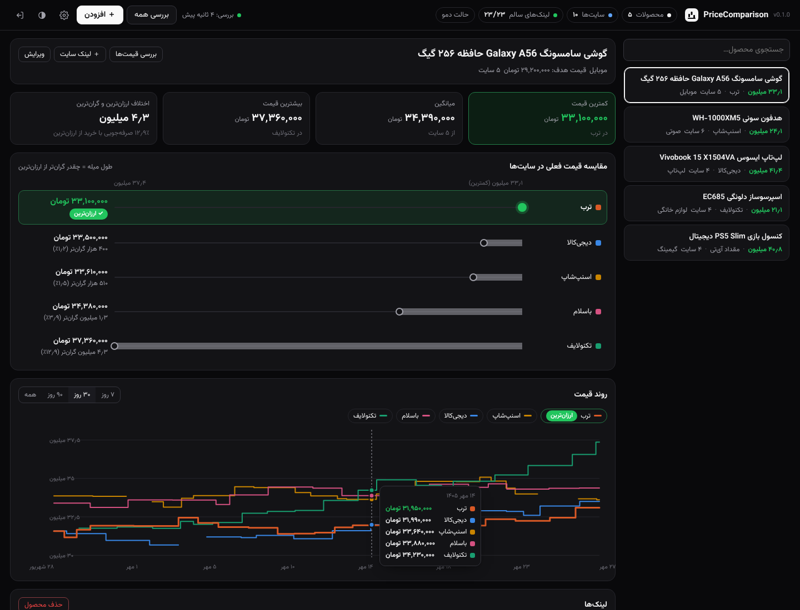
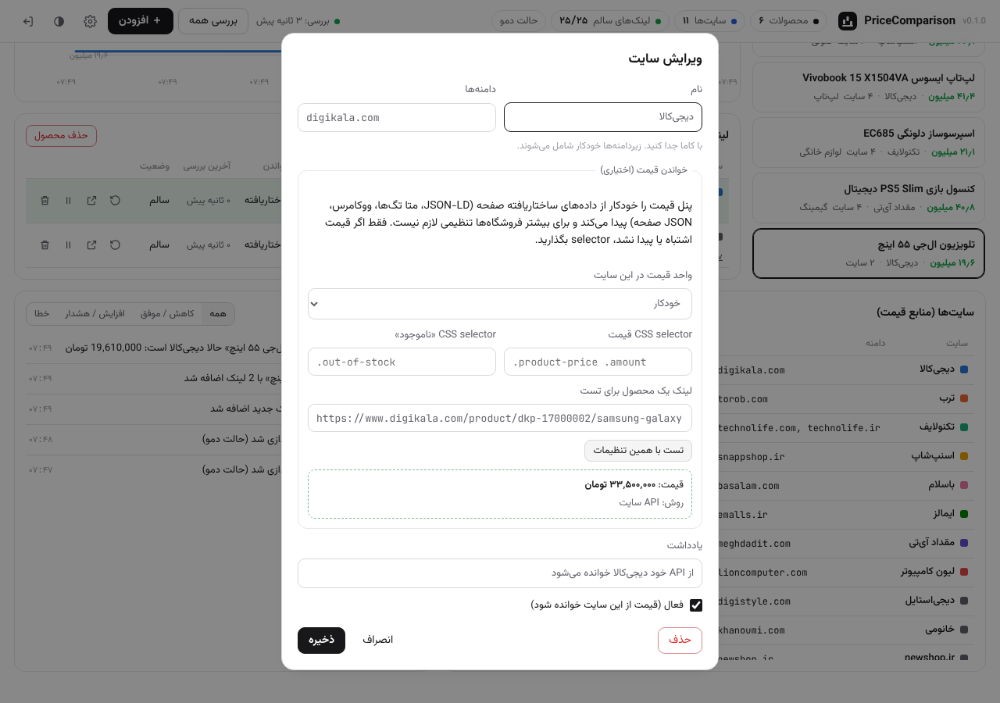
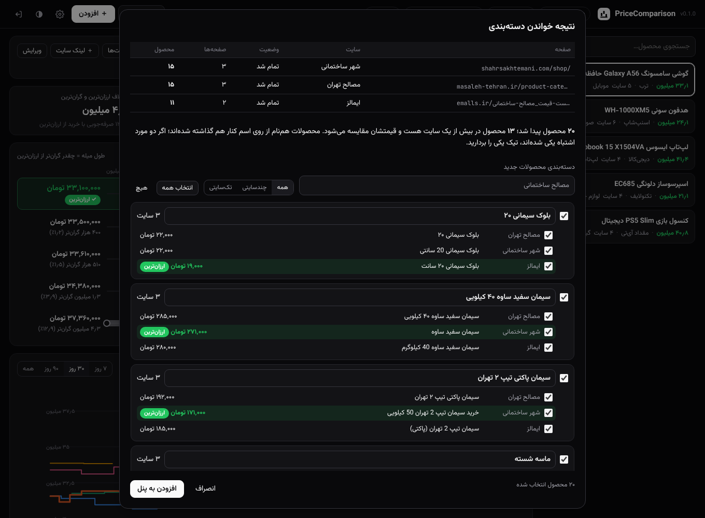

<div dir="rtl">

# PriceComparison

پنل مقایسه قیمت: قیمت هر محصول را از فروشگاه‌های اینترنتی که خودتان انتخاب می‌کنید به‌صورت دوره‌ای می‌خواند، کنار هم با نمودار نشان می‌دهد و **ارزان‌ترین فروشنده را با رنگ و برچسب جدا** می‌کند. سایت‌های منبع ثابت نیستند و از داخل پنل اضافه، ویرایش یا حذف می‌شوند.



## امکانات

- **محصولات نامحدود:** برای هر محصول لینک صفحه‌اش در هر سایت را می‌دهید. سایت هر لینک از دامنه‌اش پیدا می‌شود و اگر دامنه تعریف نشده باشد، خودکار اضافه می‌شود.
- **سایت‌های قابل تغییر:** فروشگاه‌های معروف (دیجی‌کالا، ترب، تکنولایف، اسنپ‌شاپ، باسلام، ایمالز، مقداد آی‌تی، لیون کامپیوتر، دیجی‌استایل، خانومی) از اول اضافه شده‌اند. هر کدام را می‌شود غیرفعال یا حذف کرد و هر سایت دیگری را اضافه کرد.
- **مقایسه فعلی:** ارزان‌ترین سایت سبز است و برچسب «ارزان‌ترین» دارد. طول میله هر سایت نشان می‌دهد چقدر از ارزان‌ترین گران‌تر است (مبلغ و درصد).
- **روند قیمت:** نمودار خطی برای هر سایت، با بازه ۷، ۳۰ و ۹۰ روزه. با نگه داشتن ماوس روی نمودار، قیمت همه سایت‌ها در آن روز دیده می‌شود.
- **کارت‌های خلاصه:** کمترین، میانگین و بیشترین قیمت، و اختلاف ارزان‌ترین با گران‌ترین.
- **رویدادها:** کاهش و افزایش قیمت، ناموجود شدن، عوض شدن ارزان‌ترین فروشنده، رسیدن به «قیمت هدف»، و خطا در خواندن یک سایت.
- **ورود با رمز:** یک حساب مدیر. رمز با PBKDF2 ذخیره می‌شود و نشست در کوکی امضاشده نگه داشته می‌شود.
- **حالت تاریک و روشن**، راست‌چین و سازگار با موبایل.

## قیمت چطور خوانده می‌شود (بدون هوش مصنوعی)

برای بیشتر سایت‌ها نیازی به تنظیم نیست. خواننده‌ها به ترتیب امتحان می‌شوند و اولین نتیجه برداشته می‌شود:

| روش | توضیح |
|---|---|
| API سایت | برای دیجی‌کالا از API عمومی خودش (`api.digikala.com/v2/product/<id>`) |
| CSS selector | اگر برای سایت در پنل selector تعیین شده باشد، همیشه همین استفاده می‌شود |
| داده ساختاریافته | `schema.org/Product` در JSON-LD. بیشتر فروشگاه‌ها و همه ووکامرس‌هایی که Yoast/RankMath دارند |
| متا تگ | `product:price:amount` و مشابه آن |
| Microdata | `itemprop="price"` |
| ووکامرس | باکس قیمت صفحه محصول، با تشخیص قیمت قبل و بعد از تخفیف |
| JSON صفحه | فیلدهای قیمت در `__NEXT_DATA__` سایت‌های Next.js |
| حدس از متن | اولین «عدد + تومان/ریال» بعد از عنوان محصول. در پنل با رنگ هشدار مشخص می‌شود که بهتر است selector بگذارید |

اعداد فارسی و عربی، جداکننده‌ها، و ریال یا تومان خودکار تبدیل می‌شوند. همه قیمت‌ها به تومان ذخیره می‌شوند. اگر سایتی واحد را اشتباه اعلام کند، واحدش را در تنظیمات همان سایت دستی بگذارید.

در فرم هر سایت و هر لینک یک دکمه **«تست»** هست. لینک را یک بار با همان تنظیمات می‌خواند و قیمت و روش خواندن را نشان می‌دهد.



## ورود محصولات از صفحه دسته‌بندی

به‌جای افزودن تک‌تک محصولات، از منوی «＋ افزودن ← ورود محصولات از صفحه دسته‌بندی» لینک صفحه دسته‌بندی یا فروشگاه هر سایت را بدهید، مثلاً:

```
https://shahrsakhtemani.com/shop/
https://masaleh-tehran.ir/product-category/building-materials/
https://emalls.ir/لیست-قیمت_مصالح-ساختمانی~Category~70445
```

مراحل کار:

1. **خواندن همه صفحه‌ها:** پنل همه صفحه‌های هر دسته را می‌خواند. صفحه بعد از لینک «بعدی» پیدا می‌شود. اگر صفحه چنین لینکی نداشته باشد، آدرس صفحه بعد حدس زده می‌شود: `/page/2/` در ووکامرس و `~page~2` در ایمالز.
2. **پیدا کردن محصولات:** نام، لینک و قیمت هر محصول از روی کارت‌های ووکامرس، `ItemList` در JSON-LD، یا لینک‌هایی که شکل لینک محصول دارند پیدا می‌شود.
3. **کنار هم گذاشتن محصولات یکسان (بدون هوش مصنوعی، فقط با مقایسه نام):**
   - کلماتی مثل «خرید» و «قیمت» و واحدها (کیلویی، شاخه و…) نادیده گرفته می‌شوند.
   - اگر **اعداد** فرق کنند (میلگرد ۱۲ و ۱۴، تیپ ۲ و تیپ ۵) یا بسته‌بندی فرق کند (پاکتی و فله)، دو محصول هرگز یکی نمی‌شوند.
   - محصولی که از قبل در پنل هست، به همان محصول وصل می‌شود.
4. **بازبینی:** قبل از افزودن، فهرست را می‌بینید. اسم هر محصول را می‌شود عوض کرد و هر محصول یا لینکی را که اشتباه کنار هم گذاشته شده می‌شود حذف کرد.
5. **قیمت اولیه:** قیمتی که روی صفحه دسته‌بندی نوشته شده، همان لحظه در نمودار ثبت می‌شود. بررسی بعدی، صفحه خود محصول را می‌خواند.

اگر محصولات یک سایت خودکار پیدا نشد، در تنظیمات همان سایت «selector لینک محصول در صفحه دسته‌بندی» را بگذارید.



## واحد فروش و مقایسه بر اساس واحد

سایت‌ها یک کالا را با واحدهای مختلف می‌فروشند: میلگرد را یکی کیلویی، یکی شاخه‌ای و یکی تنی؛ سیمان را یکی کیسه‌ای و یکی تنی. پنل واحد فروش هر سایت را خودکار پیدا می‌کند، همه قیمت‌ها را به یک واحد تبدیل می‌کند و بعد مقایسه می‌کند.

**از کجا واحد را می‌خواند** (به ترتیب، اولین مورد برداشته می‌شود):

| منبع | مثال |
|---|---|
| متن کنار قیمت | «۲۵٬۰۰۰ تومان / کیلوگرم»، «قیمت هر شاخه»، «(هر تن)» |
| داده ساختاریافته | `unitCode` در JSON-LD (مثل `KGM`، `TNE`، `MTK`) |
| جدول مشخصات | «واحد فروش: کیسه» و «وزن: ۵۰ کیلوگرم» |
| نام محصول | «سیمان تیپ ۲ پاکتی ۵۰ کیلویی»، «ماسه (تنی)»، «رول ۱۰ متر مربعی» |
| اندازه رایج (فرض) | کیسه سیمان ۵۰ کیلو، گچ ۴۰ کیلو، چسب کاشی ۲۰ کیلو، شاخه میلگرد ۱۲ متری |

**تبدیل‌ها:** کیلو، تن و گرم با هم؛ لیتر و متر مکعب با هم؛ متر، متر مربع و عدد هر کدام جدا. برای شاخه میلگرد، وزن از روی قطر حساب می‌شود (`قطر² ÷ ۱۶۲` کیلو در هر متر)، پس قیمت شاخه‌ای با قیمت کیلویی و تنی مقایسه‌پذیر است.

**واحد مقایسه:** برای هر محصول، واحدی که بیشتر سایت‌ها با آن می‌فروشند خودکار انتخاب می‌شود (مثلاً «هر کیسه ۵۰ کیلویی»). از بالای صفحه محصول می‌شود آن را عوض کرد، مثلاً به «هر تن». همه قیمت‌ها، ارزان‌ترین سایت، نمودارها، قیمت هدف و رویدادها بر اساس همین واحد هستند. قیمت اصلی هر سایت با واحد خودش هم کنارش نوشته می‌شود.

**وقتی واحد معلوم نیست یا جور نیست:** سایتی که واحدش پیدا نشده («واحد نامشخص») یا با واحدی می‌فروشد که قابل تبدیل نیست («واحد متفاوت»، مثلاً متر مکعب در برابر تن) در مقایسه حساب نمی‌شود و با رنگ هشدار نشان داده می‌شود. با «تعیین واحد» می‌شود واحدش را دستی نوشت (مثلاً «کیسه ۵۰ کیلویی» یا «هر تن»). واحد دستی همیشه بر تشخیص خودکار مقدم است. اندازه‌هایی که فرض شده‌اند هم با برچسب «فرض» مشخص‌اند.

اگر واحد هیچ سایتی برای یک محصول معلوم نباشد (مثل گوشی موبایل)، قیمت‌ها همان‌طور که هستند مقایسه می‌شوند.

## نصب روی لینوکس (اوبونتو)

> **مهم:** بیشتر فروشگاه‌های ایرانی درخواست از IP خارج را رد می‌کنند. پنل را روی **سرور داخل ایران** نصب کنید، یا در تنظیمات پنل یک پراکسی ایران بدهید.

اوبونتو ۲۲.۰۴ به بالا، با پایتون ۳.۱۰ به بالا:

```bash
git clone https://github.com/MHBehzadian/PriceComparison.git
cd PriceComparison
sudo bash deploy/install.sh
```

اسکریپت آدرس پنل و یک رمز تصادفی برای کاربر `admin` را چاپ می‌کند. پورت پیش‌فرض 8090 است. برای پورت دیگر:

```bash
sudo PC_PORT=9091 bash deploy/install.sh
```

تغییر رمز:

```bash
/opt/pricecomparison/venv/bin/python -m pricecomparison --data /var/lib/pricecomparison passwd
```

## نصب روی ویندوز سرور

ویندوز سرور ۲۰۱۶ به بالا. همه مراحل داخل ریموت دسکتاپ (RDP) سرور انجام می‌شود. سرور باید داخل ایران باشد، یا در تنظیمات پنل پراکسی ایران داده شود.

**۱. نصب پایتون ۳.۱۲**

از https://www.python.org/downloads/windows/ نسخه **Windows installer (64-bit)** را بگیرید. موقع نصب دو گزینه را تیک بزنید: **Add python.exe to PATH** و در Customize، گزینه **Install for all users**.

اگر مرورگر سرور اجازه دانلود نمی‌دهد (IE Enhanced Security)، همین کار را با PowerShell انجام دهید. PowerShell را **Run as Administrator** باز کنید:

```powershell
[Net.ServicePointManager]::SecurityProtocol = [Net.SecurityProtocolType]::Tls12
Invoke-WebRequest https://www.python.org/ftp/python/3.12.10/python-3.12.10-amd64.exe -OutFile $env:TEMP\python-setup.exe
Start-Process $env:TEMP\python-setup.exe -ArgumentList "/quiet InstallAllUsers=1 PrependPath=1" -Wait
```

بعد از نصب، پنجره PowerShell را ببندید و دوباره به‌صورت Administrator باز کنید.

**۲. گرفتن کد پنل**

```powershell
Invoke-WebRequest https://github.com/MHBehzadian/PriceComparison/archive/refs/heads/claude/optimistic-einstein-mftr6s.zip -OutFile $env:TEMP\pc.zip
Expand-Archive $env:TEMP\pc.zip -DestinationPath C:\ -Force
Rename-Item C:\PriceComparison-claude-optimistic-einstein-mftr6s C:\PriceComparison
```

اگر Git نصب است، `git clone -b claude/optimistic-einstein-mftr6s https://github.com/MHBehzadian/PriceComparison.git C:\PriceComparison` هم همین کار را می‌کند.

**۳. نصب و راه‌اندازی** (PowerShell به‌صورت Administrator)

```powershell
cd C:\PriceComparison
powershell -ExecutionPolicy Bypass -File deploy\windows\install.ps1
```

کارهایی که اسکریپت انجام می‌دهد:

- محیط پایتون را می‌سازد و پکیج‌ها را نصب می‌کند.
- یک رمز تصادفی برای کاربر `admin` می‌سازد و **آن را چاپ می‌کند؛ یادداشتش کنید.**
- پنل را به‌شکل یک Scheduled Task زیر حساب SYSTEM ثبت می‌کند. پنل با روشن شدن ویندوز بالا می‌آید، با خروج از ریموت خاموش نمی‌شود و اگر متوقف شود حداکثر ظرف ۵ دقیقه دوباره اجرا می‌شود.
- پورت را در فایروال ویندوز باز می‌کند و آدرس پنل را نشان می‌دهد.

برای پورت دیگر: `-Port 9091`. پیش‌فرض 8090 است و اگر اشغال باشد اسکریپت قبل از هر تغییری متوقف می‌شود.

**۴. باز کردن پنل**

- روی خود سرور: `http://localhost:8090`
- از کامپیوترهای دیگر شبکه: `http://IP-سرور:8090`. اگر باز نشد، فایروال شبکه شرکت (جدا از فایروال ویندوز) باید این پورت را باز کند. برای دسترسی از بیرون شرکت، بهتر است پنل پشت HTTPS قرار بگیرد (IIS یا nginx به‌عنوان reverse proxy).

**دسترسی از اینترنت:** آی‌پی سرور داخلی است. پنل را با پورت‌فوروارد مستقیم روی اینترنت نگذارید. آن را از طریق reverse proxy شرکت (nginx، Nginx Proxy Manager یا Caddy) با یک زیردامنه و HTTPS منتشر کنید، دقیقاً مثل بقیه سرویس‌ها. پروکسی باید **WebSocket** را عبور دهد (مسیر `/ws`، برای به‌روزرسانی زنده). نمونه nginx:

```nginx
server {
    server_name price.example.ir;
    location / {
        proxy_pass http://192.168.1.130:8090;
        proxy_http_version 1.1;
        proxy_set_header Upgrade $http_upgrade;
        proxy_set_header Connection "upgrade";
        proxy_set_header Host $host;
        proxy_set_header X-Forwarded-For $proxy_add_x_forwarded_for;
        proxy_set_header X-Forwarded-Proto $scheme;
        proxy_read_timeout 3600s;
    }
}
```

در Nginx Proxy Manager: یک Proxy Host با Forward به `http://192.168.1.130:8090` بسازید، **Websockets Support** را روشن کنید و در تب SSL گواهی Let's Encrypt و Force SSL را فعال کنید.

بعد نصب را یک بار دیگر با آی‌پی ماشین پروکسی اجرا کنید تا پنل فقط به هدرهای همان پروکسی اعتماد کند و کوکی ورود Secure شود:

```powershell
powershell -ExecutionPolicy Bypass -File deploy\windows\install.ps1 -TrustedProxy 192.168.1.X
```

**به‌روزرسانی:** کد جدید را روی همان پوشه بریزید. با ZIP: پوشه را با محتوای ZIP جدید جایگزین کنید و `venv` را نگه دارید یا بگذارید از نو ساخته شود. با Git: `git pull`. بعد همان دستور مرحله ۳ را دوباره اجرا کنید. داده‌ها در `C:\ProgramData\PriceComparison` می‌مانند و دست نمی‌خورند.

**کارهای روزمره:**

| کار | دستور (PowerShell به‌صورت Administrator) |
|---|---|
| وضعیت | `Get-ScheduledTask PriceComparison \| Get-ScheduledTaskInfo` |
| توقف / اجرا | `Stop-ScheduledTask PriceComparison` / `Start-ScheduledTask PriceComparison` |
| لاگ | `Get-Content C:\ProgramData\PriceComparison\panel.log -Tail 50` |
| تغییر رمز | `C:\PriceComparison\venv\Scripts\python -m pricecomparison --data C:\ProgramData\PriceComparison passwd` |
| حذف | `powershell -ExecutionPolicy Bypass -File deploy\windows\uninstall.ps1` (داده‌ها می‌مانند؛ با `-RemoveData` پاک می‌شوند) |
| پشتیبان | کپی پوشه `C:\ProgramData\PriceComparison` |

**سرور بدون اینترنت آزاد:** اگر pip نمی‌تواند پکیج‌ها را دانلود کند، روی یک کامپیوتر ویندوزی دیگر که اینترنت دارد و **همان نسخه پایتون** را دارد، پکیج‌ها را بگیرید:

```powershell
py -3.12 -m pip download -r requirements.txt -d wheels
```

پوشه `wheels` (حدود ۵ مگابایت) را با ریموت روی سرور کپی کنید و نصب را با `-Wheels C:\wheels` اجرا کنید.

## دمو بدون اینترنت

برای نشان دادن پنل به مشتری، بدون اتصال به هیچ سایتی. پنج محصول نمونه با ۳۰ روز تاریخچه ساخته می‌شود و قیمت‌ها شبیه‌سازی می‌شوند:

```bash
pip install -r requirements.txt
python -m pricecomparison demo        # http://127.0.0.1:8090
```

## توسعه

```bash
pip install -r requirements.txt pytest pytest-asyncio
python -m pytest
```

| فایل | کار |
|---|---|
| `pricecomparison/extract.py` | خواننده‌های عمومی قیمت از HTML |
| `pricecomparison/catalog.py` | خواندن صفحه‌های دسته‌بندی و تطبیق نام محصولات |
| `pricecomparison/importer.py` | اجرای ورود از دسته‌بندی |
| `pricecomparison/units.py` | تشخیص واحد فروش و تبدیل قیمت‌ها به یک واحد |
| `pricecomparison/scraper.py` | دریافت صفحه با فاصله بین درخواست‌ها به هر سایت، و آداپتور دیجی‌کالا |
| `pricecomparison/monitor.py` | بررسی دوره‌ای و ساخت رویدادها |
| `pricecomparison/sites.py` | فهرست سایت‌های پیش‌فرض |
| `pricecomparison/app.py` | API و WebSocket |
| `pricecomparison/static/` | رابط کاربری (JS ساده، بدون build) |

داده‌ها در یک فایل `state.json` در پوشه داده ذخیره می‌شوند.

## محدودیت‌های نسخه اولیه

- سایت‌هایی که قیمت را فقط با جاوااسکریپت در مرورگر می‌سازند و هیچ داده ساختاریافته‌ای ندارند، خوانده نمی‌شوند. برای آن‌ها در نسخه بعد مرورگر headless (Playwright) اضافه می‌شود.
- تطبیق محصولات بین سایت‌ها فقط از روی نام است. اسم‌هایی که خیلی متفاوت نوشته شده باشند یکی نمی‌شوند و باید دستی لینکشان را به محصول اضافه کرد. یکی کردن یا جدا کردن گروه‌ها در صفحه بازبینی هنوز نیست.
- تبدیل بین واحدهایی که به چگالی کالا بستگی دارند (مثل متر مکعب ماسه به تن) انجام نمی‌شود؛ این سایت‌ها «واحد متفاوت» نشان داده می‌شوند.
- یک حساب کاربری. چند کاربر با سطح دسترسی و هشدار تلگرامی برای مراحل بعد هستند.

</div>
